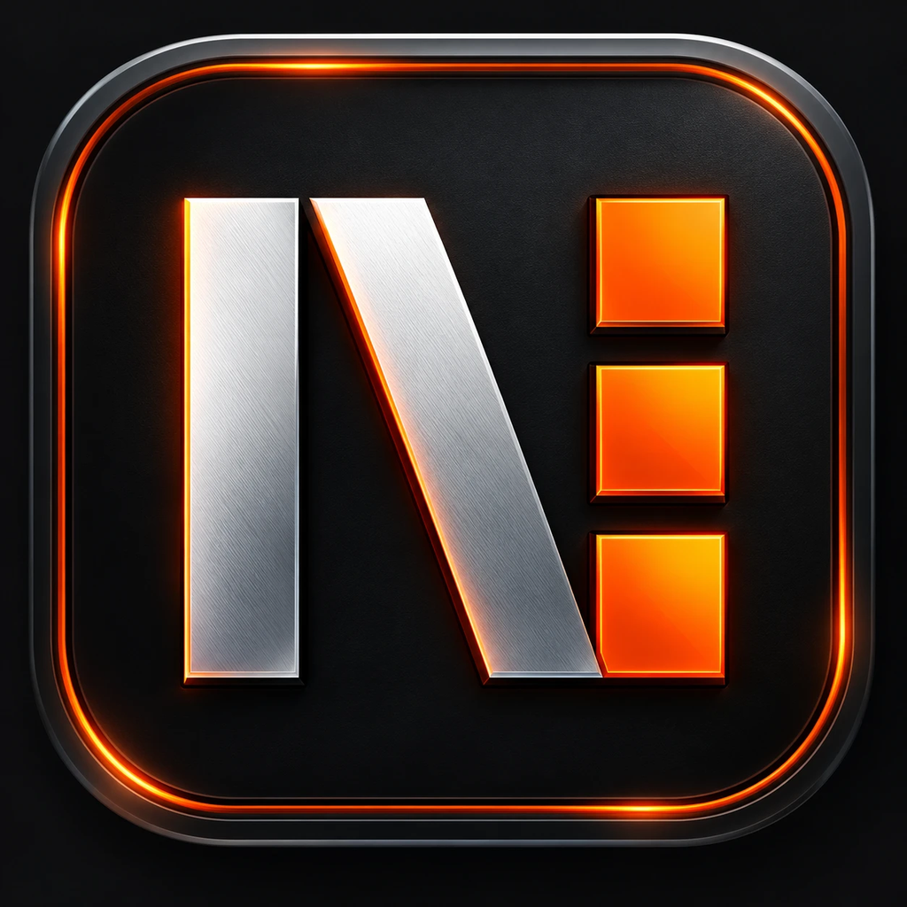
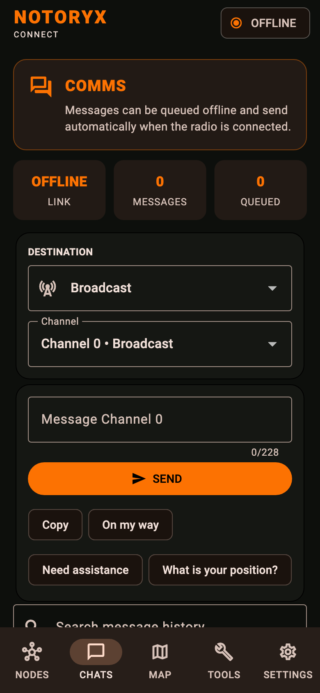
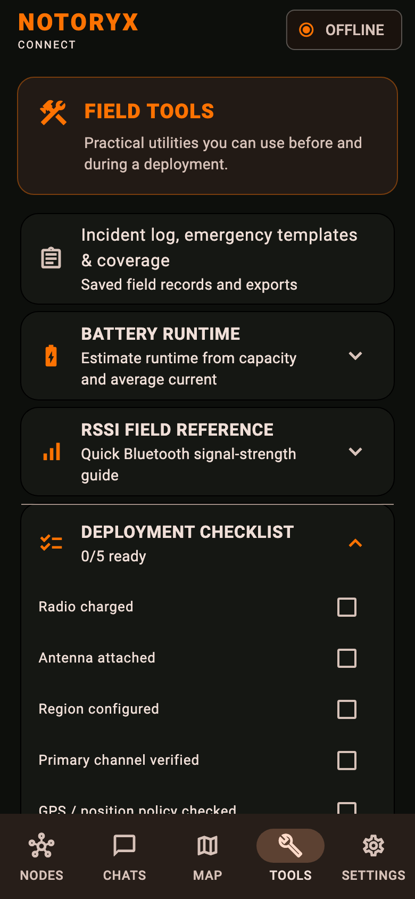

  

# NOTORYX Connect downloads

**An independent Android field app for LoRa mesh radios running Meshtastic® firmware.** Part of the **NOTORYX** off-grid communications family. **No Towers. No Limits.**

This repository hosts NOTORYX Connect builds. Get the latest from **[Releases](../../releases)**. The source code is at [TheLogsAreScreaming/notoryx-connect](https://github.com/TheLogsAreScreaming/notoryx-connect) (GPL-3.0).

  
  
  

> NOTORYX Connect is a beta, checked on one radio so far. Don't rely on it as your only way to call for help.

## Which file do I need?

Download the `…-arm64.apk` from the latest release (ARM64 Android phones). Releases may also include an `.aab` (for the Play Store, not for installing directly), checksums in `SHA256SUMS.txt`, and device test guides.

## Install on Android

1. On your phone, open the latest release and download the `.apk`.
2. Open the file. If Android asks, allow installs from your browser or file manager.
3. Open NOTORYX Connect and allow **Bluetooth**, **location** and **notifications** when asked.

**Coming from v0.1.3-beta.1 or earlier?** The app ID is changing from `org.backcountrysignal.bastion` to `com.bastionmesh.connect`, so the next release installs as a separate app. In the old app, make a backup (**Settings → Phone data backup / restore**), install the new app, restore the backup there, then uninstall the old one. You only do this once.

## About

NOTORYX Connect (formerly Bastion) is independently developed and is not affiliated with, sponsored by, endorsed by, or an official application of Meshtastic LLC. Meshtastic® is a registered trademark of Meshtastic LLC; references to it describe compatibility only.
