

  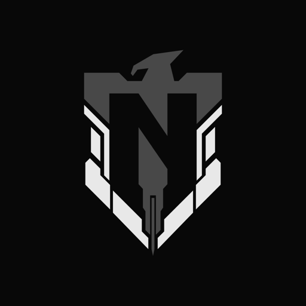

# NOTORYX Connect downloads

**An independent field app for LoRa mesh radios running Meshtastic® firmware, for Android, macOS and Windows.** Part of the **NOTORYX** off-grid communications family. **No Towers. No Limits.**

This repository hosts NOTORYX Connect builds. Get the latest from **[Releases](../../releases)**. The source code is at [TheLogsAreScreaming/notoryx-connect](https://github.com/TheLogsAreScreaming/notoryx-connect) (GPL-3.0).

  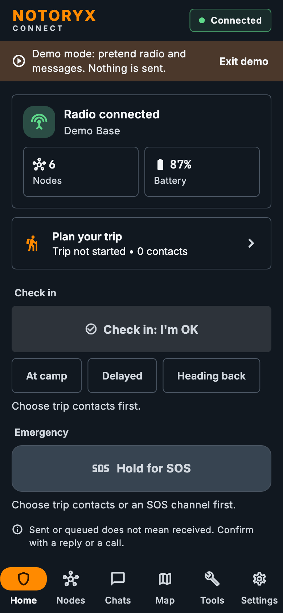
  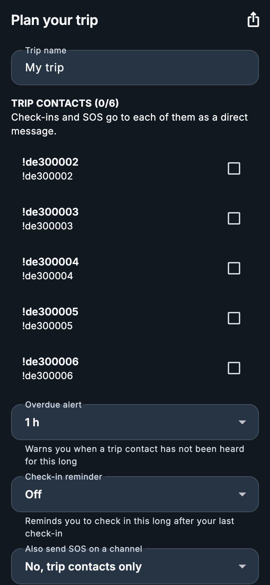
  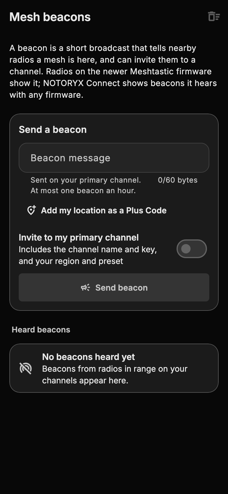
  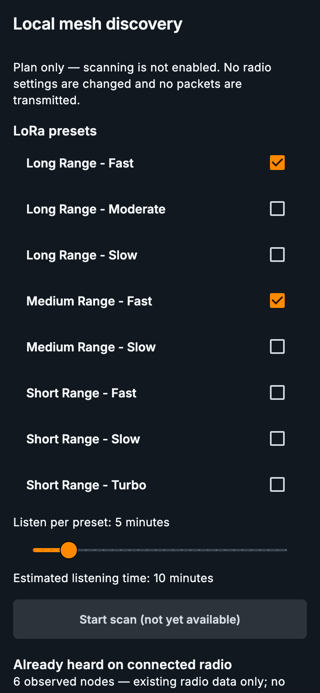

  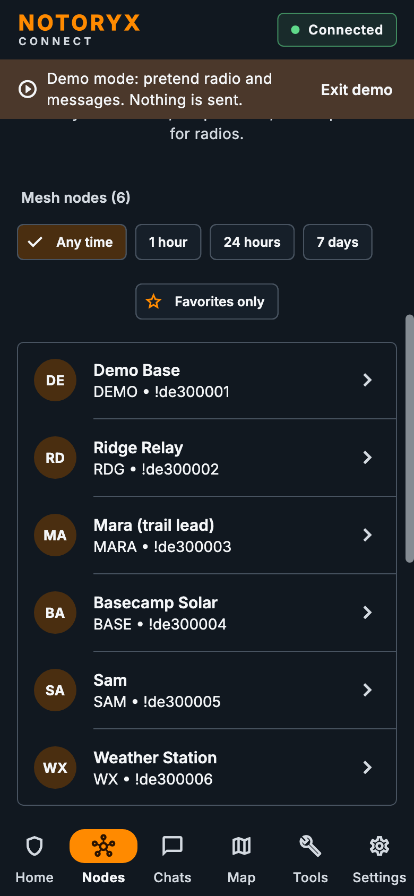
  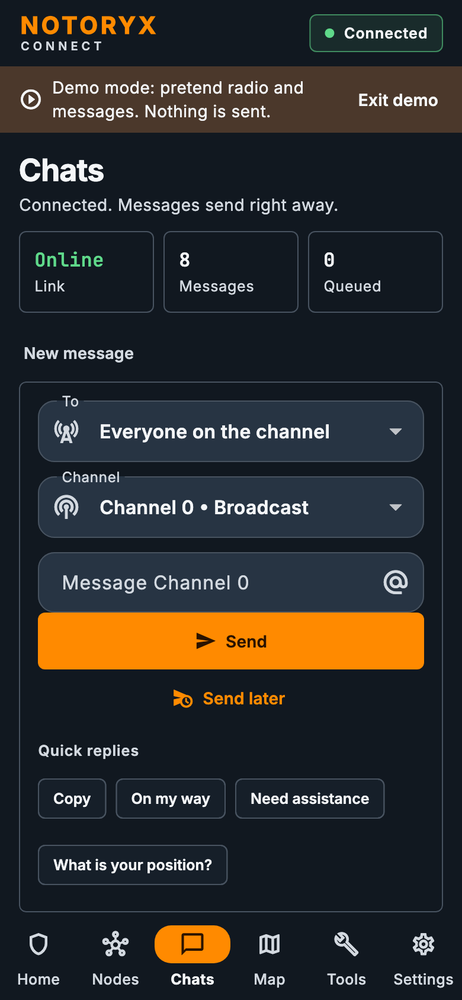
  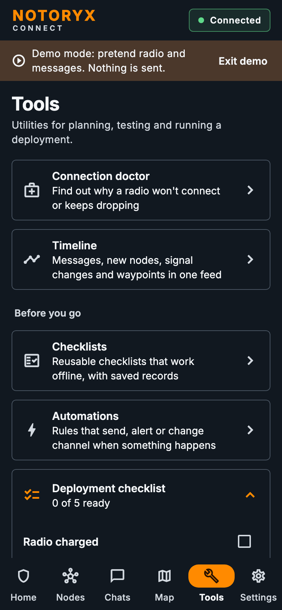
  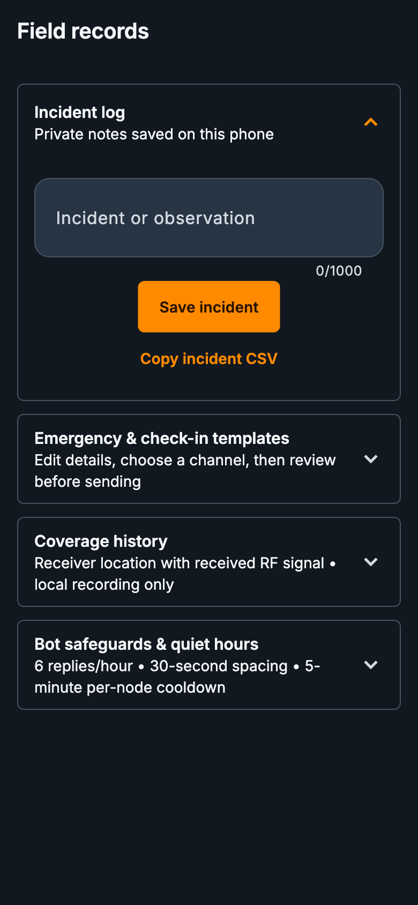

Screenshots are from the app's built-in demo mode (a pretend radio and mesh).

## Why NOTORYX Connect?

Most mesh apps are built for poking at radios at your desk. NOTORYX Connect is built for when you're out there and the cell bars are gone.

- **It's built for the field.** A dark, high-contrast interface with big targets, a deployment checklist, battery runtime math, an incident log and check-in templates. Everything you reach for at the trailhead is one tap from the bottom bar.
- **It watches your back.** Plan a trip with up to 6 contacts, check in with one tap, and **hold for SOS** to repeat a call for help until someone answers. The team map shows where each contact was last heard, how long ago, and the trail they took.
- **It doesn't pretend.** Every radio setting you save is read back from the radio before the app calls it done. If the radio didn't take the change, you'll know. Delivery states come from real routing acknowledgments, not a hopeful checkmark.
- **Your messages don't vanish.** Type with no radio connected and they queue on the phone, then go out when the link comes back. History, queues and nodes are kept separately for every radio you own.
- **It stays connected.** Bluetooth, Wi-Fi or USB. A background service keeps the link up with the screen off, it reconnects on its own when you walk back into range, and the connection doctor explains what's wrong when it can't.
- **Your data is yours.** No account, no analytics, no ads and no NOTORYX servers. Everything stays in the app's private storage on your phone, location sharing is opt-in and can be rounded before it leaves the phone, and backups are encrypted with your password.
- **The bot has manners.** Bot Mode auto-replies with quiet hours, rate limits, per-node cooldowns and loop protection, so it can't spam the mesh.
- **Try it without a radio.** Demo mode gives you a pretend radio and mesh to explore. Nothing is sent.
- **It's free and open source.** GPL-3.0, independently built, with its own identity. In English, Spanish, French and German.

## What's new since the first betas

Everything below shipped between v1.0.0-beta.5 and v1.0.0-beta.17 (the latest, 2026-11-15). See each release for details.

- **Connect over Wi-Fi or USB** as well as Bluetooth, with a **connection doctor**, **demo mode**, a home-screen widget and a Quick Settings tile.
- **Trip readiness** check, airtime-aware SOS, a **check-in delivery map**, zone and off-route alerts, **day replay** of team positions, and a shareable trip plan.
- **NodeVault** with a favorites filter, **node journal**, telemetry charts, **network diagram**, **mesh health** and node-key change alerts.
- Map: **place search**, rally points and routes, traceroute on the map, coverage heatmap, **topo map and line-of-sight planner**, **GPX/KML/GeoJSON layers** and **offline maps from MBTiles**, plus a list view for screen readers.
- Messaging: reactions, replies, @mentions, pins and unread markers, **forward** and **send later**, delivery receipts that say whether the radio proved delivery, hops and signal on each message, an airtime estimate while typing, and a lookalike-name warning.
- **SALUTE** and **9-Line** report forms, **automations**, a **timeline**, offline **checklists**, and optional **community moderation** (off by default).
- **Two-way ATAK** (asks before sharing positions), **MQTT client proxy**, **remote admin**, per-channel position precision, identity key backup and a new-radio checklist.
- Optional **app lock** and **encrypted chat history** in an on-phone database.
- **Eight themes** in the NOTORYX Core look, and **Spanish, French and German** translations (unreviewed).
- **macOS and Windows** downloads.

## Everything it does

### Trip safety
- **Home** tab with a field console: radio status, node count and battery.
- **Plan your trip:** up to 6 trip contacts, an overdue alert (30 min to 8 h) and a check-in reminder.
- **Check in** with one tap: I'm OK, At camp, Delayed or Heading back. Each goes to every trip contact as a direct message with the time, your position and battery. You see who it reached and can resend to the rest.
- **Hold for SOS** for 2 seconds (TalkBack users get a confirmation instead). It goes to your trip contacts and optionally a channel, repeats every 5 minutes up to 12 times, stops when a contact answers, and **I'm safe** sends an all-clear.

### Connecting
- Scan for nearby radios with live Bluetooth signal strength, then connect in one tap.
- A verified session: NOTORYX Connect checks the Meshtastic service, runs the PhoneAPI handshake and syncs the node database before it says **READY**.
- Automatic reconnect with backoff. It respects a manual disconnect and waits for Android Bluetooth to come back on.
- Background connection service so the link survives the screen turning off.

### Messaging
- Channel and direct messages, with a thread for each node.
- Delivery states from routing acknowledgments.
- Offline queue: messages wait on the phone and send when the radio reconnects.
- Choose any enabled channel slot for each message. The 228-byte limit is shown as you type.
- Quick replies: Copy, On my way, Need assistance, What is your position?
- Search across all saved messages, including queued ones.
- Message timeline and received-signal (SNR) history for the session.
- Chat history (500 to 5,000 messages per conversation, your choice), queues and nodes kept separately for each radio.
- Optional message notifications.
- Emoji reactions (tap a message), a draft saved for each conversation, and a **via MQTT** label on messages that came over the internet.
- **Ignore** or **mute** a node, and hide messages containing words you choose. An SOS reply from a trip contact is never missed, even if you ignored them.
- Optional automatic deletion of old channel messages (direct messages are kept) and reading new messages aloud.
- App-icon shortcuts: Check in / SOS, Chats, Nodes and Map.

### Nodes and NodeVault
- Live mesh node list with mesh health and signal for the session.
- **NodeVault:** every node your radios have heard, saved on the phone, with favorites and your own notes.
- Node details: telemetry, position, signal history and neighbors.
- Request position or telemetry from a node.
- **Traceroute** with the SNR of every hop.

### Maps and location
- Map of node positions and waypoints from the mesh. Create your own waypoints too.
- **Team view:** each trip contact's status (fresh, stale or lost), distance, direction and battery, with the position's age on their pin.
- **Trails** of where your trip contacts and you have been over the last 24 hours.
- **Export GPX** of waypoints and trails to open in other mapping apps.
- **Units:** miles and feet, or kilometers and meters, set from your region by default.
- OpenStreetMap areas you've viewed are cached offline for a year.
- Opt-in phone location sharing, with optional rounding (about 360 m, 1.5 km or 6 km) before it leaves the phone.
- Low-power field mode, which lowers GPS accuracy and update rate to save battery.

### Field tools
- **Deployment checklist:** radio charged, antenna attached, region configured, primary channel verified, GPS/position policy checked.
- **Battery runtime calculator** from battery capacity and average current.
- **RSSI field reference:** what Bluetooth signal-strength numbers mean in practice.
- **Incident log:** up to 500 private notes, tagged with your radio, exportable as CSV.
- **Emergency and check-in templates** (assistance, check-in, all-clear). You fill in the details, pick a channel and review the exact text before it's sent.
- **Coverage history:** record where you were and the signal (SNR and RSSI) you received from each node, then export it as CSV. It keeps up to 2,000 readings for 30 days and stops on its own when you disconnect.
- **Range test** log with signal and distance for each packet, and gaps that show lost packets.
- **Store & forward:** replay messages you missed from a router node.
- **Mesh beacons:** see the beacons your radio hears, review and join a channel a beacon offers, or send a beacon by hand (up to once an hour).
- **Local mesh discovery** (read-only for now): plan a listen across LoRa presets and see the nodes your radio has already heard.

### Field alerts (phone notifications only, nothing is sent over the mesh)
- Low battery on your radio or a favorite, at a threshold you set.
- A new node heard for the first time.
- A favorite going quiet for longer than you set while you're connected.

### Bot Mode
- Away auto-reply on a channel you choose.
- Quiet hours (default 22:00–07:00), 6 replies an hour, 30 seconds between replies and a 5-minute cooldown per node.
- Ignores replays, old messages, replies from NOTORYX bots and messages meant for other nodes.

### Radio management
- Edit every config section and module through a generated settings form: owner, LoRa (modem preset, transmit, RX boosted gain, external LNA), channels, device role, position (fixed position, smart broadcast) and more.
- **Settings availability** check shows which sections your radio actually returns.
- Saves need an authenticated, connected session and your confirmation, and every save is verified with a fresh read from the same radio.
- Share channels as `meshtastic.org/e/#` links or QR codes, and import them by link or by scanning a QR code with the camera. Add to your channels or replace them all.

### Backups and privacy
- **Encrypted radio backup and restore:** settings, all channel slots, owner names and modules, encrypted with AES-256-GCM (PBKDF2, 600,000 iterations). Preview before restoring, then the result is read back from the radio. Device identity keys and session credentials are never included.
- **Encrypted phone data backup** to a file: chats and queues for every radio, NodeVault, waypoints, field records and settings. Perfect for moving to a new phone. Restore rolls back if anything fails.
- **Privacy & data** screen that lists exactly what's stored and what's sent, with buttons to delete chat history or all phone data.

### Look and feel
- Eight themes (Blaze is the default; Bare Beauty is the light one), with accents checked for readable contrast.
- Hide the dashboard sections you don't use.
- Follows your phone's text size. Status switches to an icon with a spoken label when text is large.

  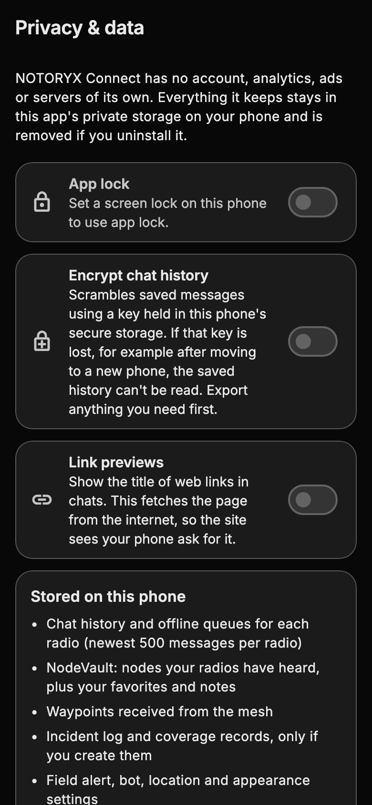
  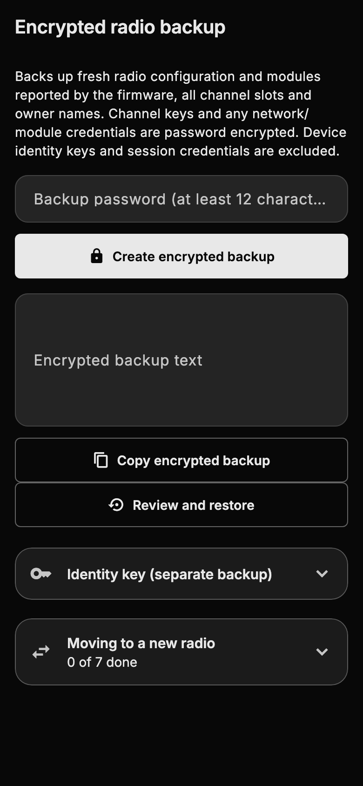
  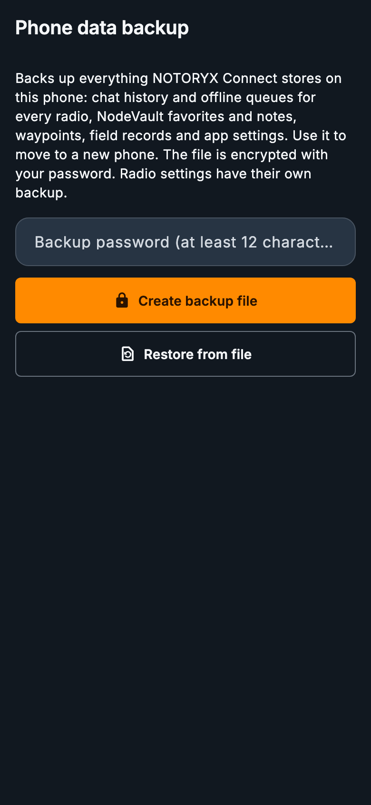
  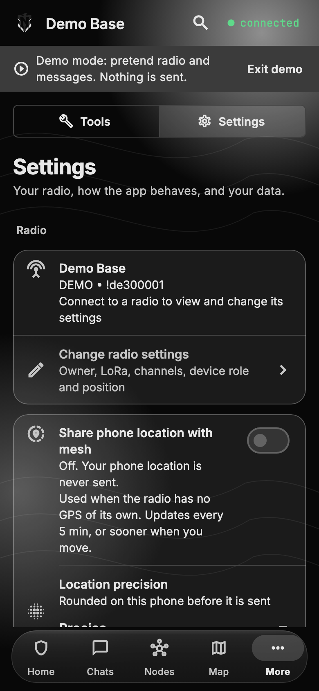

> NOTORYX Connect is a test beta. The latest betas were checked on one phone (a Samsung Galaxy A15) with one radio (a Seeed T1000-E). Many newer features, and the macOS and Windows builds, have automated tests but haven't been checked on a range of hardware yet. Don't rely on it as your only way to call for help.

## Which file do I need?

| You have | Download | Notes |
|---|---|---|
| An Android phone (ARM64) | `NOTORYX-Connect-<version>-<build>.apk` | Signed with the release key. Check it with `SHA256SUMS.txt` and `SIGNATURE.txt` |
| A Mac (Intel or Apple silicon) | `NOTORYX-Connect-<version>-<build>-macOS-universal.zip` | Not notarized: right-click the app and choose **Open** the first time |
| A Windows PC (64-bit) | `NOTORYX-Connect-<version>-<build>-Windows-x64-setup.exe` or `-Windows-x64.zip` | Installs for your user, no admin needed. Not code signed, so SmartScreen warns on first launch |

The `.aab` is for the Play Store, not for installing directly. There is no iPhone release yet.

Betas are marked as pre-releases, so look through the **[Releases](../../releases)** list rather than only at "Latest". The newest is **v1.0.0-beta.17** (build 21).

## Install on Android

1. On your phone, open the latest release and download the `.apk`.
2. Open the file. If Android asks, allow installs from your browser or file manager.
3. Open NOTORYX Connect and allow **Bluetooth**, **location** and **notifications** when asked.
4. For a steady background link, set the app's battery use to **Unrestricted** (**Settings → Background connection** shows how).

**Updating?** Newer betas install over older ones and keep your data. Don't uninstall first.

**Coming from v0.1.3-beta.1 or earlier?** The app ID changed from `org.backcountrysignal.bastion` to `com.bastionmesh.connect`, so the new app installs separately. In the old app, make a backup (**Settings → Phone data backup / restore**), install the new app, restore the backup there, then uninstall the old one. You only do this once.

## About

NOTORYX Connect (formerly Bastion) is independently developed and is not affiliated with, sponsored by, endorsed by, or an official application of Meshtastic LLC. Meshtastic® is a registered trademark of Meshtastic LLC; references to it describe compatibility only.
