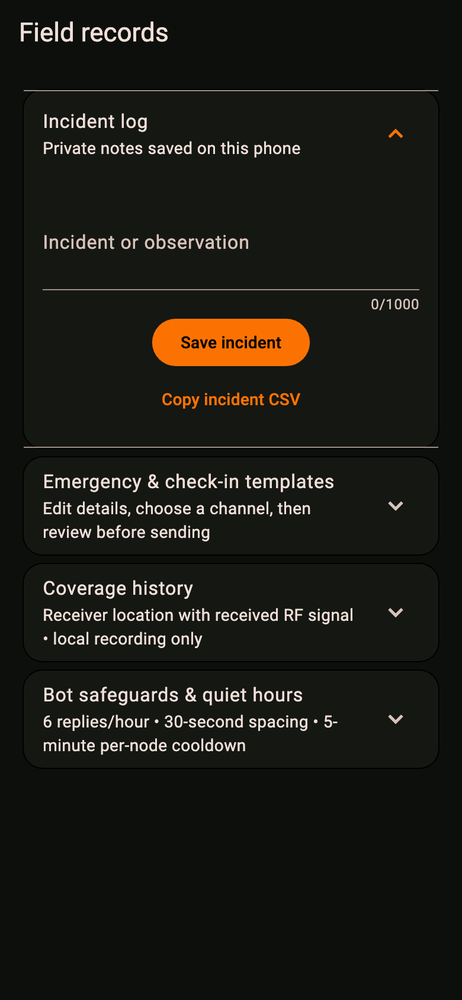
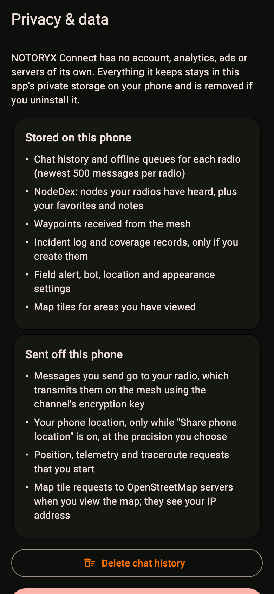
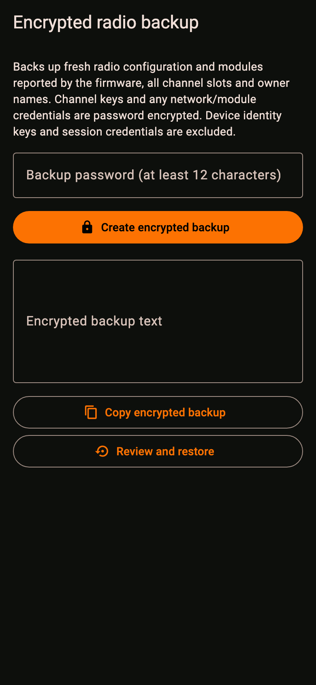
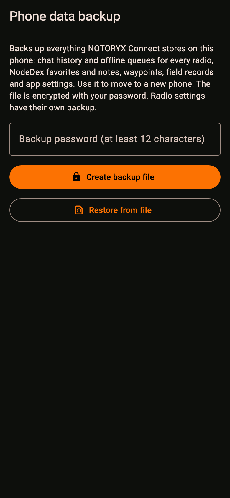
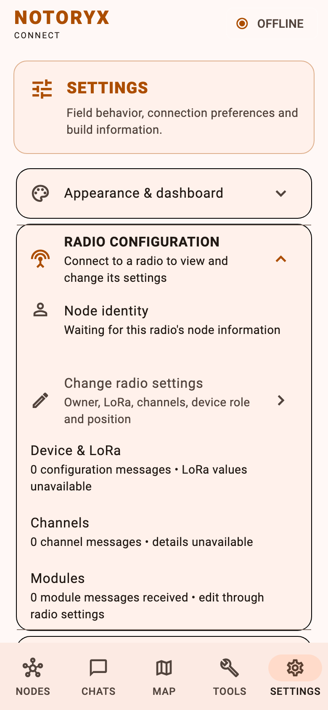

  

# NOTORYX Connect downloads

**An independent Android field app for LoRa mesh radios running Meshtastic® firmware.** Part of the **NOTORYX** off-grid communications family. **No Towers. No Limits.**

This repository hosts NOTORYX Connect builds. Get the latest from **[Releases](../../releases)**. The source code is at [TheLogsAreScreaming/notoryx-connect](https://github.com/TheLogsAreScreaming/notoryx-connect) (GPL-3.0).

  
  
  
  

## Why NOTORYX Connect?

Most mesh apps are built for poking at radios at your desk. NOTORYX Connect is built for when you're out there and the cell bars are gone.

- **It's built for the field.** A dark, high-contrast interface with big targets, a deployment checklist, battery runtime math, an incident log and check-in templates. Everything you reach for at the trailhead is one tap from the bottom bar.
- **It doesn't pretend.** Every radio setting you save is read back from the radio before the app calls it done. If the radio didn't take the change, you'll know. Delivery states come from real routing acknowledgments, not a hopeful checkmark.
- **Your messages don't vanish.** Type with no radio connected and they queue on the phone, then go out when the link comes back. History, queues and nodes are kept separately for every radio you own.
- **It stays connected.** A background service keeps the Bluetooth link up with the screen off, and it reconnects on its own when you walk back into range or flip Bluetooth back on.
- **Your data is yours.** No account, no analytics, no ads and no NOTORYX servers. Everything stays in the app's private storage on your phone, location sharing is opt-in and can be rounded before it leaves the phone, and backups are encrypted with your password.
- **The bot has manners.** Bot Mode auto-replies with quiet hours, rate limits, per-node cooldowns and loop protection, so it can't spam the mesh.
- **It's free and open source.** GPL-3.0, independently built, with its own identity.

## Everything it does

### Connecting
- Scan for nearby radios with live Bluetooth signal strength, then connect in one tap.
- A verified session: NOTORYX Connect checks the Meshtastic service, runs the PhoneAPI handshake and syncs the node database before it says **READY**.
- Automatic reconnect with backoff. It respects a manual disconnect and waits for Android Bluetooth to come back on.
- Background connection service so the link survives the screen turning off.

### Messaging
- Channel and direct messages, with a thread for each node.
- Delivery states from routing acknowledgments.
- Offline queue: messages wait on the phone and send when the radio reconnects.
- Choose any enabled channel slot for each message. The 228-byte limit is shown as you type.
- Quick replies: Copy, On my way, Need assistance, What is your position?
- Search across all saved messages, including queued ones.
- Message timeline and received-signal (SNR) history for the session.
- Chat history (newest 500 per radio), queues and nodes kept separately for each radio.
- Optional message notifications.

### Nodes and NodeDex
- Live mesh node list with mesh health and signal for the session.
- **NodeDex:** every node your radios have heard, saved on the phone, with favorites and your own notes.
- Node details: telemetry, position, signal history and neighbors.
- Request position or telemetry from a node.
- **Traceroute** with the SNR of every hop.

### Maps and location
- Map of node positions and waypoints from the mesh. Create your own waypoints too.
- OpenStreetMap areas you've viewed are cached offline for a year.
- Opt-in phone location sharing, with optional rounding (about 360 m, 1.5 km or 6 km) before it leaves the phone.
- Low-power field mode, which lowers GPS accuracy and update rate to save battery.

### Field tools
- **Deployment checklist:** radio charged, antenna attached, region configured, primary channel verified, GPS/position policy checked.
- **Battery runtime calculator** from battery capacity and average current.
- **RSSI field reference:** what Bluetooth signal-strength numbers mean in practice.
- **Incident log:** up to 500 private notes, tagged with your radio, exportable as CSV.
- **Emergency and check-in templates** (assistance, check-in, all-clear). You fill in the details, pick a channel and review the exact text before it's sent.
- **Coverage history:** record where you were and the signal (SNR and RSSI) you received from each node, then export it as CSV. It keeps up to 2,000 readings for 30 days and stops on its own when you disconnect.
- **Range test** log with signal and distance for each packet, and gaps that show lost packets.
- **Store & forward:** replay messages you missed from a router node.

### Field alerts (phone notifications only, nothing is sent over the mesh)
- Low battery on your radio or a favorite, at a threshold you set.
- A new node heard for the first time.
- A favorite going quiet for longer than you set while you're connected.

### Bot Mode
- Away auto-reply on a channel you choose.
- Quiet hours (default 22:00–07:00), 6 replies an hour, 30 seconds between replies and a 5-minute cooldown per node.
- Ignores replays, old messages, replies from NOTORYX bots and messages meant for other nodes.

### Radio management
- Edit every config section and module through a generated settings form: owner, LoRa (modem preset, transmit, RX boosted gain, external LNA), channels, device role, position (fixed position, smart broadcast) and more.
- **Settings availability** check shows which sections your radio actually returns.
- Saves need an authenticated, connected session and your confirmation, and every save is verified with a fresh read from the same radio.
- Share channels as `meshtastic.org/e/#` links or QR codes, and import them by link or by scanning a QR code with the camera. Add to your channels or replace them all.

### Backups and privacy
- **Encrypted radio backup and restore:** settings, all channel slots, owner names and modules, encrypted with AES-256-GCM (PBKDF2, 600,000 iterations). Preview before restoring, then the result is read back from the radio. Device identity keys and session credentials are never included.
- **Encrypted phone data backup** to a file: chats and queues for every radio, NodeDex, waypoints, field records and settings. Perfect for moving to a new phone. Restore rolls back if anything fails.
- **Privacy & data** screen that lists exactly what's stored and what's sent, with buttons to delete chat history or all phone data.

### Look and feel
- Dark (default), light or system theme, with a NOTORYX orange accent checked for readable contrast.
- Hide the dashboard sections you don't use.
- Follows your phone's text size. Status switches to an icon with a spoken label when text is large.

  
  
  
  

> NOTORYX Connect is a beta, checked on one radio (a Seeed T1000-E) so far. Don't rely on it as your only way to call for help.

## Which file do I need?

Download the `…-arm64.apk` from the latest release (ARM64 Android phones). Releases may also include an `.aab` (for the Play Store, not for installing directly), checksums in `SHA256SUMS.txt`, and device test guides.

## Install on Android

1. On your phone, open the latest release and download the `.apk`.
2. Open the file. If Android asks, allow installs from your browser or file manager.
3. Open NOTORYX Connect and allow **Bluetooth**, **location** and **notifications** when asked.

**Coming from v0.1.3-beta.1 or earlier?** The app ID is changing from `org.backcountrysignal.bastion` to `com.bastionmesh.connect`, so the next release installs as a separate app. In the old app, make a backup (**Settings → Phone data backup / restore**), install the new app, restore the backup there, then uninstall the old one. You only do this once.

## About

NOTORYX Connect (formerly Bastion) is independently developed and is not affiliated with, sponsored by, endorsed by, or an official application of Meshtastic LLC. Meshtastic® is a registered trademark of Meshtastic LLC; references to it describe compatibility only.
